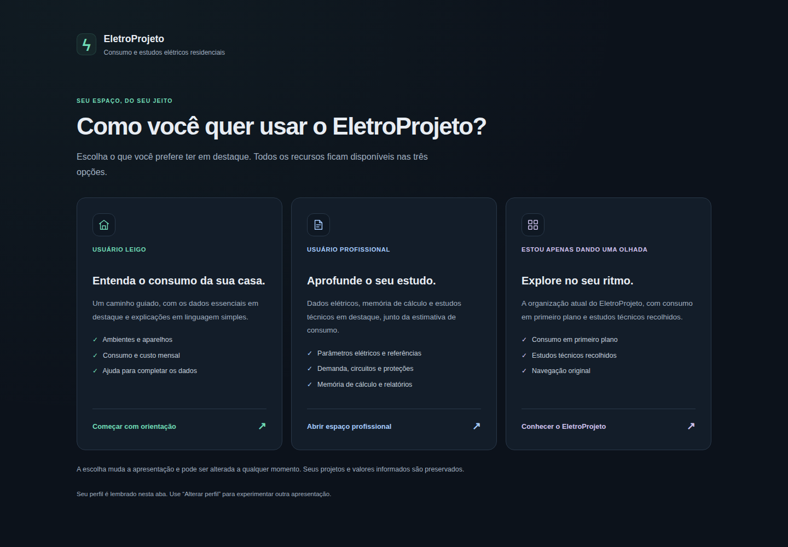

# EletroProjeto

Entenda o consumo de energia da sua casa.

Organize ambientes e aparelhos, informe como são usados e acompanhe uma estimativa de consumo e custo mensal. Para moradias prontas ou planejadas: **Projeto → Imóvel → Ambientes → Equipamentos → Estimativas → Relatório**.

**[Abrir no navegador (GitHub Pages)](https://thegodkodda.github.io/eletroprojeto/)** · **[Baixar ZIP com iniciadores](https://github.com/thegodKoDDa/eletroprojeto/releases/latest/download/EletroProjeto-source.zip)** · [Todas as versões](https://github.com/thegodKoDDa/eletroprojeto/releases) · [Licença ISC](LICENSE)



## Recursos

- Ambientes e aparelhos com catálogo de referências e valores editáveis.
- Consumo por horários de uso ou consumo informado na etiqueta/medição.
- Custo mensal pela tarifa informada, com detalhamento por ambiente e aparelho.
- Projetos versionados, autosave, recuperação de rascunhos e lixeira.
- PDF e JSON com resultados, hipóteses e dados pendentes.
- Potência instalada, média diária anualizada, consumo mensal/anual, custos, ranking e memória de cálculo.
- Tipo e estágio do imóvel: planejado, em construção, pronto ou em reforma.

Os resultados são estimativas matemáticas, não medições reais. Potências do catálogo são sugestões editáveis. Consumo funciona sem distribuidora ou instalação definitiva; custo usa tarifa manual opcional e não representa a fatura completa.

## Escolha como usar

| Forma | Requisitos | Início |
| --- | --- | --- |
| **Online pelo navegador (GitHub Pages)** | Navegador atualizado | Acesse **[https://thegodkodda.github.io/eletroprojeto/](https://thegodkodda.github.io/eletroprojeto/)** sem baixar ou instalar nada |
| **ZIP com iniciadores** | Python 3.11+, Node.js 20.9+ e npm | Extraia e abra `Iniciar-EletroProjeto.cmd` no Windows ou execute `sh iniciar-eletroprojeto.sh` no Linux/macOS |
| **Docker Compose** | Docker com Compose | `docker compose up --build` na pasta extraída ou clonada |
| **Código-fonte** | Python, Node.js, npm e Git | Clone e execute o iniciador ou os serviços manualmente |

### Online pelo navegador (GitHub Pages)

Acesse diretamente **[https://thegodkodda.github.io/eletroprojeto/](https://thegodkodda.github.io/eletroprojeto/)** para usar o EletroProjeto sem baixar ou instalar nada. O motor Python original de cálculos e relatórios é executado no próprio navegador via WebAssembly (Pyodide), e os projetos ficam salvos localmente no armazenamento do seu navegador, com exportação de relatórios em PDF e JSON.

### Baixar e iniciar

1. [Baixe o ZIP](https://github.com/thegodKoDDa/eletroprojeto/releases/latest/download/EletroProjeto-source.zip) e extraia toda a pasta.
2. Com Python e Node.js instalados, use o iniciador do seu sistema.
3. Na primeira execução, aguarde a preparação das dependências e a compilação. O navegador abre quando a aplicação estiver disponível.

O ZIP contém fontes e iniciadores, não um executável com runtimes embutidos. A primeira preparação precisa de internet; depois, os serviços e os dados funcionam localmente. Não é um site para abrir por `index.html`. [Hashes SHA-256](https://github.com/thegodKoDDa/eletroprojeto/releases/latest/download/SHA256SUMS.txt) · [Manifesto da versão](https://github.com/thegodKoDDa/eletroprojeto/releases/latest/download/build-manifest.json).

### Docker

Na pasta do projeto:

```sh
docker compose up --build
```

Abra **http://127.0.0.1:3000**. Python e Node.js ficam dentro da imagem; não precisam estar instalados no computador. O banco fica em um volume persistente. `docker compose down` encerra os serviços sem remover esse volume. Não use a remoção de volumes como forma de atualizar.

### Clonar o código

```sh
git clone https://github.com/thegodKoDDa/eletroprojeto.git
cd eletroprojeto
python3 scripts/start_local.py --setup
```

No Windows, abra `Iniciar-EletroProjeto.cmd` ou use `py -3 scripts/start_local.py --setup`. O iniciador reutiliza dependências compatíveis, prepara o banco sem reset e só encerra os processos que ele iniciou. Se uma porta estiver ocupada, informa o conflito e preserva os serviços existentes.

Configuração de portas, dados, atualização e execução manual: [guia de instalação](docs/setup.md).

## Como usar

A `main` 0.25.1 concentra o sistema em estimativas residenciais. A release estável publicada0.24.1 é anterior à reformulação; uma nova release/implantação não foi presumida. Escolha **USUÁRIO LEIGO**, **USUÁRIO PROFISSIONAL** ou **ESTOU APENAS DANDO UMA OLHADA**; os perfis mudam apresentação, sem alterar cálculos, dados ou permissões.

1. **Projeto e imóvel:** nome, localização contextual, tipo/estágio e tarifa opcional.
2. **Ambientes e aparelhos:** referências editáveis, kWh da etiqueta ou potência e horários efetivos.
3. **Resultados e Estimativas:** potência, média diária, consumo mensal/anual, custos e distribuições; salve/exporte o relatório atual.

Normas de fornecimento, demanda, circuitos e proteções foram retirados do fluxo/API de estimativas. Acervo e projetos anteriores permanecem preservados e desacoplados. Veja o [guia de uso](docs/usage.md).

## Dados e recuperação

Banco, credenciais, checkpoints e originais técnicos não acompanham o download. Cada instalação mantém seus próprios dados. O iniciador usa `data/eletroprojeto.db` em uma cópia nova; preserva o banco legado em `backend/eletroprojeto.db` quando ele já existe. Docker tem volume separado. PDF/JSON são relatórios, não backups completos. Consulte [continuidade e recuperação](docs/continuity.md).

## Desenvolvimento

Next.js, TypeScript e Tailwind no frontend; Python, FastAPI, Pydantic e SQLAlchemy no backend. Migrações com Alembic, SQLite e portabilidade para PostgreSQL. A matemática elétrica fica em um único motor Python.

| Diretório | Conteúdo |
| --- | --- |
| `backend/` | API, cálculos, persistência, relatórios e testes |
| `frontend/` | Interface, cliente da API e testes de navegador |
| `scripts/` | Inicialização, distribuição, continuidade e verificações |
| `docs/` | Guias, referências técnicas e histórico |

Consulte [Contribuir](CONTRIBUTING.md), [arquitetura](docs/architecture.md), [limitações conhecidas](docs/KNOWN_ISSUES.md) e [histórico de versões](CHANGELOG.md). O [índice da documentação](docs/README.md) reúne os demais guias.

## Licença

[ISC](LICENSE). Componentes de terceiros conservam suas [licenças e avisos](THIRD_PARTY_NOTICES.md).
