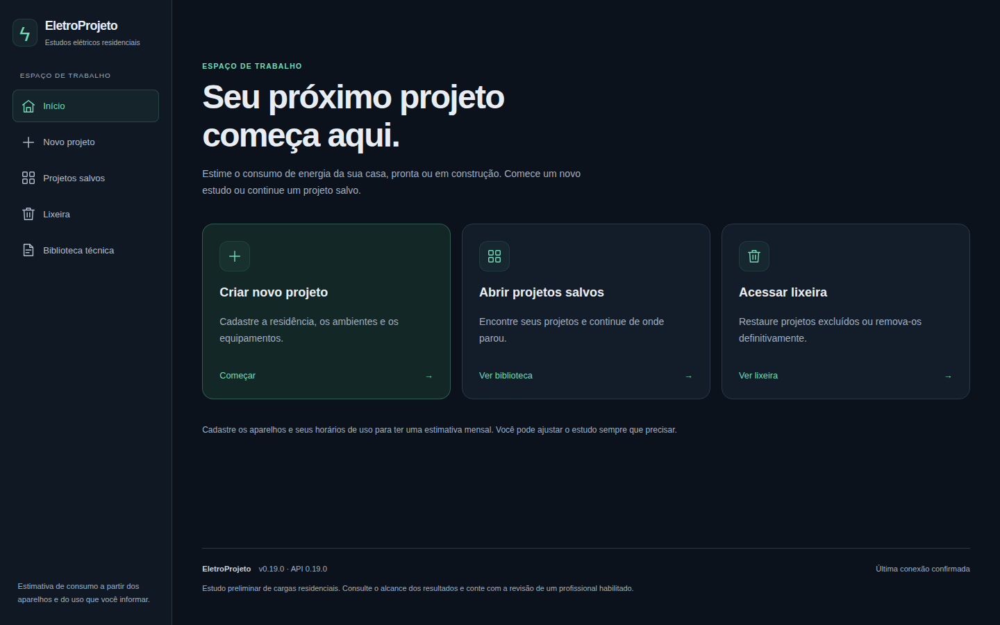

# EletroProjeto

Entenda o consumo de energia da sua casa.

Organize ambientes e aparelhos, informe como são usados e acompanhe uma estimativa de consumo e custo mensal. Para moradias prontas ou planejadas, com um fluxo simples: **Projeto → Ambientes → Conferência**.



## Recursos

- Cadastro de ambientes e aparelhos, com catálogo de referências e valores editáveis.
- Estimativa de consumo por horários de uso ou consumo informado na etiqueta/medição.
- Custo mensal a partir da tarifa informada, com detalhamento por ambiente e aparelho.
- Projetos versionados, salvamento automático, recuperação de rascunhos e lixeira.
- Relatórios PDF e JSON com resultados, hipóteses e dados pendentes.
- Estudos elétricos opcionais, com fontes, condições de aplicação e memória de cálculo.

Os resultados dependem dos dados informados. Consumo estimado não representa a fatura completa; estudos elétricos não substituem o projeto e a verificação da instalação.

## Começar

Requer **Python 3.11+**, **Node.js 20.9+** e npm. Para preparar uma nova instalação, siga o [guia de instalação](docs/setup.md). Se o ambiente já está preparado, inicie a API:

```sh
cd backend
.venv/bin/python -m uvicorn app.main:app --host 127.0.0.1 --port 8000
```

Em outro terminal, a partir da raiz do projeto:

```sh
cd frontend
npm run dev
```

Abra **http://127.0.0.1:3000**. A documentação interativa da API fica em **http://127.0.0.1:8000/docs**. No Windows, use o interpretador do ambiente conforme o [guia de instalação](docs/setup.md#windows).

## Como usar

1. **Projeto:** identifique a residência e informe a tarifa, se quiser estimar o custo.
2. **Ambientes:** adicione os aparelhos, confira suas potências e informe horários ou consumo mensal.
3. **Conferência:** consulte resultados e pendências, salve o projeto e exporte um relatório.

Demanda, circuitos, localização de componentes e referências territoriais ficam em **Estudos técnicos**, sem tornar o cadastro básico mais complexo. Veja o [guia de uso](docs/usage.md).

## Dados e recuperação

Projetos e históricos ficam no SQLite local. Banco, credenciais, checkpoints e originais da biblioteca técnica ficam fora do GitHub. PDF/JSON são relatórios; não substituem a cópia do banco para recuperação completa. Consulte [continuidade e recuperação](docs/continuity.md).

## Desenvolvimento

Interface em **Next.js, TypeScript e Tailwind**; API e motor de cálculos em **Python, FastAPI, Pydantic e SQLAlchemy**. Migrações com Alembic e banco SQLite, preservando compatibilidade com PostgreSQL.

| Diretório | Conteúdo |
| --- | --- |
| `backend/` | API, cálculos, persistência, relatórios e testes |
| `frontend/` | Interface, cliente da API e testes de navegador |
| `scripts/` | Continuidade, manutenção e verificações |
| `docs/` | Guias, referências técnicas e histórico |

Para configuração, testes e contratos, consulte [Contribuir](CONTRIBUTING.md).

## Documentação

- [Instalação e configuração](docs/setup.md)
- [Guia de uso](docs/usage.md)
- [Arquitetura](docs/architecture.md)
- [Cálculos e referências](docs/calculations.md)
- [Limitações conhecidas](docs/KNOWN_ISSUES.md)
- [Histórico de versões](CHANGELOG.md)

O [índice da documentação](docs/README.md) reúne os demais guias e registros técnicos.
