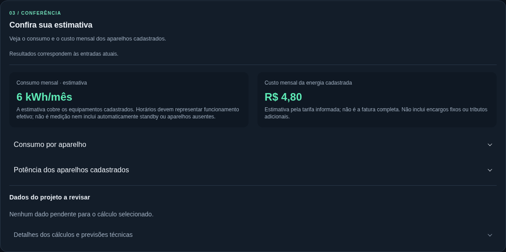

# Guia de uso

O EletroProjeto estima o consumo elétrico de uma residência pronta ou planejada. Você informa os aparelhos e como são usados; a aplicação organiza os resultados por ambiente e equipamento.

## 1. Projeto

Na tela inicial, escolha **Criar novo projeto**. Informe um nome e o município. A tarifa é opcional: sem ela, o consumo ainda pode ser estimado; com ela, aparece também o custo calculado para a energia informada.

Use a tarifa da sua conta ou contrato. O custo apresentado não inclui automaticamente bandeiras, tributos, iluminação pública ou outras parcelas da fatura.

## 2. Ambientes

Adicione os cômodos e escolha os aparelhos no catálogo, ou cadastre uma carga personalizada. Confira a quantidade e a potência elétrica. Uma referência de catálogo representa um modelo identificado; valores da placa ou do fabricante têm prioridade.

Para estimar o consumo de cada unidade, informe uma das bases:

- **Consumo mensal em kWh:** da etiqueta, de uma medição ou de outra referência identificada.
- **Horários de uso:** potência elétrica, horas por dia e dias por mês, considerando as condições de funcionamento do aparelho.

A aplicação não presume horários, tarifas ou potência elétrica a partir de BTU/h. Se um dado não é conhecido, mantenha-o ausente; um campo pendente não significa consumo zero. Equipamentos cíclicos podem exigir medição ou uma referência de consumo mais adequada que a potência nominal.

## 3. Conferência

Consulte o consumo e o custo estimados, o detalhamento por aparelho e as pendências. Os atalhos levam ao ambiente e ao campo que precisa de informação. Ao editar uma entrada, o resultado anterior fica oculto até o novo cálculo.

A imagem é um exemplo fictício de funcionamento, não uma recomendação de potência, tarifa ou horário.

## Salvar e recuperar

**Salvar projeto** registra a edição e seu histórico. O salvamento automático pode ser ativado depois do primeiro salvamento manual. Rascunhos locais ajudam a recuperar edições ainda não enviadas; não substituem o banco e podem se perder ao limpar o navegador ou trocar de dispositivo.

Use **Abrir projetos salvos** para continuar um projeto. A lixeira permite restaurar projetos removidos. Em caso de conflito entre versões, escolha a recuperação indicada pela interface; não há sobrescrita silenciosa.

## Exportar

PDF e JSON apresentam o resultado atual, as hipóteses de uso, a cobertura e as pendências. Um cálculo desatualizado precisa terminar antes da exportação. JSON de relatório não é um backup completo para restaurar projetos.

Detalhes do formato e da rastreabilidade estão em [formulários e relatórios](forms-and-pdf.md); cópias completas e recuperação, em [continuidade](continuity.md).

## Estudos técnicos opcionais

Na conferência, abra **Estudos técnicos** apenas quando precisar de uma análise adicional. Demanda, circuitos, localização de componentes e consulta territorial exigem dados e condições específicos. Nenhum desses estudos é obrigatório para estimar o consumo.

Os procedimentos têm cobertura limitada e fontes identificadas. Uma posição, seção ou demanda estimada não declara conformidade final da instalação. Consulte [cálculos](calculations.md), [referências](standards.md) e [limitações conhecidas](KNOWN_ISSUES.md).

Nos circuitos, escolha isolação/método/arranjo reais; terminais para90°C, condições enterradas e afastamentos precisam ser conferidos. D exige temperatura do solo e referência limitada; G exige circuito único trifásico equilibrado sem neutro. Dados de impedância próprios são necessários para queda em XLPE/EPR e D/E/F/G. Os painéis DPS/seletividade comparam documentação de produtos e estudo informado, sem selecionar proteção final.

Em **Referência territorial · ANEEL**, a consulta municipal opcional usa código IBGE de sete dígitos, mostra todas as empresas com relação positiva no último mês declarado por cada uma e preserva datas/atrasos. Confirme a empresa que atende o endereço pela fatura/contrato; a consulta não troca a distribuidora do projeto.
